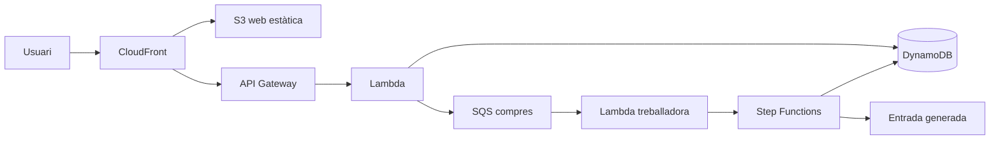

# Especificació del projecte — Plataforma de venda d'entrades d'alta concurrència

| | |
|---|---|
| **Assignatura** | ACAP |
| **Equip** | Adrià, Emma, Marc, Abel |
| **Plataforma** | Amazon Web Services (AWS) |
| **Tipus** | Aplicació web de venda d'entrades, amb èmfasi en escalabilitat i consistència sota allau de peticions |

## 1. Resum

El projecte és una web de venda d'entrades, en la línia de Ticketmaster, pensada per aguantar allaus de gent en el moment en què s'obren les taquilles d'un esdeveniment popular. L'objectiu de l'assignatura no és només que es pugui comprar una entrada, sinó demostrar que el sistema escala, que els usuaris entren per torns i que **mai es ven dues vegades el mateix seient**.

El nucli entregable cobreix consultar esdeveniments, passar per una sala d'espera virtual, reservar un seient i completar la compra. Les compres no arriben directament a la base de dades: entren en una cua (SQS) perquè el sistema no se saturi, i un flux coordinat (Step Functions) executa els passos de reservar, pagar i generar l'entrada.

La demo simula molts usuaris comprant alhora i mostra, amb gràfiques, com respon el sistema.

## 2. Objectius

1. Construir una taquilla en línia que suporti pics de trànsit sense caure ni vendre el mateix seient a dues persones.
2. Separar l'accés (sala d'espera) de la compra (cua de comandes i orquestració), de manera que la càrrega es pugui absorbir i processar a un ritme controlat.
3. Fer visible el comportament del sistema sota càrrega: cues, latència, errors i recuperació.
4. Deixar el nucli tancat i uns mòduls d'ampliació independents, perquè l'equip pugui créixer el projecte sense bloquejar l'entrega mínima.

## 3. Abast

### 3.1. Nucli

El nucli és el que s'ha d'entregar sí o sí. Ho fan aquests serveis:

| Peça | Servei |
|---|---|
| Web estàtica (catàleg, sala d'espera, compra) | S3 + CloudFront |
| API | API Gateway + Lambda |
| Esdeveniments, seients i comandes | DynamoDB |
| Cua de compres, per no saturar el backend | SQS |
| Coordinació: reservar, pagar i generar l'entrada | Step Functions |

Funcions del nucli:

- Veure el llistat d'esdeveniments i el detall (data, recinte, zones, preu, aforament).
- Entrar a una sala d'espera virtual i avançar per torns quan s'obre la venda.
- Reservar un seient concret durant un temps limitat.
- Pagar (pagament simulat a la demo) i rebre l'entrada.
- Garantir que un seient en estat venut o reservat vigent no es pot assignar a ningú més.

### 3.2. Mòduls d'ampliació

Cada mòdul és opcional respecte del nucli i es pot desenvolupar en paral·lel un cop el flux bàsic existeix. L'ordre de sota és una prioritat suggerida, no una obligació: el mòdul 7 (càrrega, caos i observabilitat) és el que fa visible la resta i convé tenir-lo encara que alguns mòduls intermedis no es facin.

#### Mòdul 1. Notificacions, correu i cues

- **Amazon SES** envia l'entrada, la confirmació de compra i els recordatoris, amb plantilles.
- **Gestió de rebots.** SES avisa per **SNS** quan un correu rebota o es marca com a spam. L'avís arriba a una cua **SQS**, que el processa (marcar el correu com a invàlid, no reintentar-lo sense límit).
- **Dead-letter queues.** Les comandes que fallen diverses vegades passen a una altra cua per revisar-les, en lloc de perdre's o reintentar-se per sempre.
- **Cues FIFO** a la sala d'espera, per respectar l'ordre d'arribada.
- **EventBridge Scheduler** programa recordatoris automàtics, per exemple 24 hores abans del concert.

Aquest mòdul és el lloc natural per explotar el servei de cues d'AWS: cua estàndard de compres, cua FIFO d'espera, cua de rebots i dead-letter queue, amb polítiques de reintent i de reencaminament.

#### Mòdul 2. Sala d'espera en temps real amb cau

- **ElastiCache (Redis)** guarda la cua d'espera i el mapa de seients en memòria. L'accés és molt més ràpid que anar a DynamoDB a cada consulta de disponibilitat.
- **API Gateway WebSocket** perquè l'usuari vegi la seva posició i els seients ocupant-se en directe.
- **Experiment:** comparar el rendiment amb cau i sense cau sota la mateixa càrrega, i documentar la diferència.

DynamoDB continua sent la font de veritat de la venda. Redis accelera la lectura i la sala d'espera; l'escriptura que tanca la venda ha de seguir sent atòmica a la base de dades.

#### Mòdul 3. Preu dinàmic i analítica

- **Kinesis Data Streams** rep en temps real cada visita, reserva i compra.
- Una **Lambda** ajusta el preu segons la demanda, com en els vols.
- Canal d'analítica: **Kinesis Data Firehose → S3 → Glue → Athena**, per consultar les vendes amb SQL (quant s'ha venut per minut, quines zones s'esgoten abans).

#### Mòdul 4. Antifrau i antibots

- **AWS WAF** davant de CloudFront o de l'API: límit de peticions i bloqueig de bots.
- Detecció de compres sospitoses, per exemple la mateixa targeta o la mateixa IP comprant moltes entrades. Es pot fer amb regles o amb un model a **SageMaker**.
- Entrades signades amb **KMS**, de manera que el QR no es pugui falsificar: la validació comprova la signatura, no només el contingut del codi.

#### Mòdul 5. Assistent amb IA

- Un xatbot amb **Amazon Bedrock** que respon preguntes com «quins concerts hi ha aquest cap de setmana per menys de 30 €?» consultant el catàleg.
- Alternativa o complement: un assistent que recomana esdeveniments a partir de les compres anteriors de l'usuari.

#### Mòdul 6. Revenda oficial i llista d'espera

- Si algú retorna una entrada, **Step Functions** l'ofereix al primer de la llista d'espera, amb un termini per comprar-la.
- Si el termini venç sense compra, passa al següent.
- L'avís es fa per **SNS** o **SES**.
- El seient no torna al mapa lliure general mentre hi ha una oferta vigent a la llista d'espera.

#### Mòdul 7. Robustesa i experiments de càrrega

És el mòdul que demostra el projecte.

- Proves de càrrega amb milers d'usuaris simulats (obertura de venda, sala d'espera i compra simultània).
- Enginyeria del caos amb **AWS Fault Injection Service**: fer fallar una Lambda o saturar una cua a propòsit i ensenyar que el sistema es recupera (reintents, dead-letter queue, venda coherent).
- **CloudWatch** i **X-Ray** per mesurar latència, errors, profunditat de les cues i traces del flux de compra, i per documentar els resultats amb gràfiques.

## 4. Requisits funcionals del nucli

| ID | Requisit |
|---|---|
| RF-01 | L'usuari pot llistar esdeveniments publicats i obrir-ne el detall. |
| RF-02 | En obrir-se la venda, l'usuari entra en una sala d'espera i rep un torn. No accedeix al mapa de seients fins que li toca. |
| RF-03 | L'ordre de la sala d'espera és l'ordre d'arribada. Amb el mòdul 1, aquesta garantia la dona una cua FIFO. |
| RF-04 | Quan li toca el torn, l'usuari veu els seients lliures, reservats i venuts. |
| RF-05 | Reservar un seient el bloqueja durant un temps acotat (per exemple 5 minuts). Si no es paga, torna a quedar lliure. |
| RF-06 | Dos usuaris no poden reservar ni comprar el mateix seient. La segona operació ha de fallar de forma explícita. |
| RF-07 | La compra es lliura a una cua SQS. El client rep un identificador de comanda i un estat, no un processament síncron il·limitat. |
| RF-08 | Step Functions executa, en ordre: confirmar la reserva, cobrar (simulat) i generar l'entrada. Si un pas falla, la reserva no es converteix en venda. |
| RF-09 | En cas d'èxit, l'usuari obté una entrada associada a aquell seient i a aquella comanda. |
| RF-10 | L'usuari pot consultar l'estat de la comanda: en cua, reservant, pagant, confirmada o fallida. |

Requisits dels mòduls, quan s'implementin:

| ID | Mòdul | Requisit |
|---|---|---|
| RF-11 | 1 | En confirmar la compra s'envia un correu amb l'entrada, a partir d'una plantilla SES. |
| RF-12 | 1 | Un rebot o una queixa de spam queda registrat i el correu deixa de rebre enviaments. |
| RF-13 | 1 | Una comanda que supera el nombre de reintents queda a la dead-letter queue i es pot inspeccionar. |
| RF-14 | 1 | Es programa un recordatori abans de l'esdeveniment. |
| RF-15 | 2 | La posició a la sala d'espera i el mapa de seients s'actualitzen en directe per WebSocket. |
| RF-16 | 3 | El preu d'una zona pot canviar segons la demanda recent, amb un sostre i un terra configurats. |
| RF-17 | 3 | Es pot consultar amb SQL el volum de vendes per minut i l'ordre en què s'esgoten les zones. |
| RF-18 | 4 | Un excés de peticions o un bot conegut és bloquejat pel WAF. |
| RF-19 | 4 | Una compra que concentra moltes entrades en la mateixa targeta o IP queda marcada per revisió. |
| RF-20 | 4 | El QR de l'entrada porta una signatura KMS que es pot verificar. |
| RF-21 | 5 | L'assistent respon preguntes sobre el catàleg amb dades reals, no inventades. |
| RF-22 | 6 | Una entrada retornada s'ofereix al cap de la llista d'espera amb un termini; si no es compra, passa al següent. |
| RF-23 | 7 | Hi ha un escenari de càrrega repetible i un informe amb les mètriques obtingudes. |

## 5. Requisits no funcionals

| ID | Requisit |
|---|---|
| RNF-01 | **Unicitat del seient.** L'invariant principal del sistema: un seient té com a màxim una reserva vigent o una venda. S'implementa amb escriptura condicional a DynamoDB (l'actualització només té èxit si l'estat esperat encara és «lliure» o «reservat per aquesta comanda»). |
| RNF-02 | **Absorció de pics.** L'obertura de la venda no ha de fer caure l'API. La sala d'espera limita qui arriba al mapa, i SQS desacobla qui ja compra de qui processa la compra. |
| RNF-03 | **Resposta acotada a l'usuari.** Entrar a la sala i enviar la compra responen ràpid. El treball lent (pagament, generació de l'entrada, correu) és asíncron. |
| RNF-04 | **Reintents segurs.** Tornar a processar el mateix missatge de la cua no ven el seient una segona vegada ni genera dues entrades. Les operacions són idempotents (clau de comanda i de seient). |
| RNF-05 | **Caducitat.** Una reserva no pagada s'allibera sola. Una oferta de revenda no acceptada també. |
| RNF-06 | **Observabilitat.** Els fluxos del nucli deixen mètriques i traces suficients per explicar, a la demo, què ha passat durant una allau. |
| RNF-07 | **Cost de demo.** Els recursos es poden apagar o són de capa gratuïta o de baix cost. No es deixa una càrrega de milers d'usuaris corrent sense control. |
| RNF-08 | **Pagament simulat.** El nucli no integra una passarel·la real. El pas de pagament és un servei simulat amb èxit i error injectables, prou realista per provar el flux i el caos. |

## 6. Arquitectura del nucli

Papers de cada peça:

- **S3 + CloudFront** serveixen la interfície i absorbeixen el trànsit de lectura de la web sense tocar el backend.
- **API Gateway + Lambda** exposen el catàleg, l'entrada a la sala d'espera, la reserva i l'enviament de la compra.
- **DynamoDB** guarda esdeveniments, mapa de seients, torns i comandes. L'unicitat del seient es tanca aquí, amb condicions d'escriptura.
- **SQS** rep les compres ja validades a nivell de reserva. Si arriben milers de pagaments alhora, la cua creix i els treballadors consumeixen al ritme que el sistema aguanta.
- **Step Functions** és el procediment de la comanda: comprovar la reserva, pagar, marcar el seient com a venut i generar l'entrada. Un fallada deixa la comanda en un estat conegut i el seient no queda venut a mitges.

La sala d'espera del nucli pot ser una taula DynamoDB amb un número de torn i una finestra de quants usuaris poden passar a la vegada. La cua FIFO i el WebSocket queden als mòduls 1 i 2; el nucli ja ha de tenir el concepte de torn i de porta tancada.

## 7. Fluxos principals

### 7.1. Obertura de la venda

1. L'usuari obre l'esdeveniment. Si la venda no és oberta, veu la compte enrere.
2. Quan s'obre, entra a la sala d'espera i obté un torn.
3. El sistema deixa passar un nombre fix d'usuaris cap al mapa de seients.
4. La resta espera. La posició es pot consultar (en el nucli, per sondeig; amb el mòdul 2, per WebSocket).

### 7.2. Reserva i compra

1. L'usuari tria un seient lliure.
2. La API intenta una escriptura condicional: el seient passa a «reservat» només si encara era «lliure», amb identitat de comanda i data de caducitat.
3. Si la condició falla, l'usuari veu que el seient ja no està disponible.
4. Si té èxit, la compra es publica a SQS i la interfície passa a mostrar l'estat de la comanda.
5. Step Functions executa reservar (confirmar que la reserva segueix vigent), pagar i generar l'entrada.
6. El seient passa a «venut» i l'entrada queda associada a la comanda.
7. Si el pagament falla o la reserva ha caducat, el flux s'atura, la comanda queda fallida i el seient es pot alliberar.

### 7.3. Alliberament

Un procés periòdic, o el mateix flux, busca reserves vençudes i les torna a «lliure» només si encara pertanyen a aquella comanda. Això evita alliberar un seient que ja s'ha venut.

### 7.4. Cues, rebots i missatges perduts

Quan s'implementi el mòdul 1, el sistema de cues queda així:

| Cua | Tipus | Per a què |
|---|---|---|
| Comptes de compra | Estàndard | Absorbir l'allau de pagaments. El processament pot ser en paral·lel. |
| Sala d'espera | FIFO | Garantir l'ordre d'arribada. |
| Rebots de correu | Estàndard | Rebre, via SNS, els rebots i les queixes de SES. |
| Dead-letter de compres | Estàndard o FIFO, segons l'origen | Comandes que han esgotat els reintents. |

Un missatge de compra només va a la dead-letter queue després d'un nombre configurat d'intents. No es descarta en silenci.

## 8. Model de dades (nucli)

Entitats mínimes a DynamoDB. Les claus concretes es tancaran a l'implementació; aquí es fixa què s'ha de poder consultar.

**Esdeveniment.** Identificador, nom, artista o títol, recinte, data, estat de la venda (programada, sala d'espera, oberta, esgotada, finalitzada).

**Zona.** Esdeveniment, nom, preu base, aforament.

**Seient.** Esdeveniment, zona, fila, número, estat (`lliure`, `reservat`, `venut`, `ofereix_llista_espera`), identificador de la comanda que el té, caducitat de la reserva.

**Torn de sala d'espera.** Esdeveniment, identificador d'usuari o de sessió, número de torn, instant d'entrada, estat (`esperant`, `admes`, `expirat`).

**Comanda.** Identificador, esdeveniment, seient, estat (`en_cua`, `reservant`, `pagant`, `confirmada`, `fallida`, `en_dead_letter`), clau d'idempotència.

**Entrada.** Identificador, comanda, seient, codi (al nucli, un identificador; amb el mòdul 4, el mateix contingut signat amb KMS).

**Usuari de demo.** Identificador i correu. N'hi ha prou amb una identitat senzilla; el projecte no és un sistema de comptes.

## 9. Què ha d'ensenyar la demo

La demo ha de tenir un guió curt i repetible:

1. Un esdeveniment amb un mapa de seients petit i visible.
2. L'obertura de la venda amb molts usuaris simulats entrant a la sala d'espera.
3. Uns quants usuaris reals (o pestanyes) comprant mentre la simulació corre, per veure torns, seients que desapareixen i una compra que completa.
4. Un intent deliberat de quedar-se el mateix seient des de dos clients, amb la segona compra rebutjada.
5. Gràfiques, durant o just després de la prova, de peticions, profunditat de la cua, comandes confirmades, errors i temps de punta a punta.
6. Si el mòdul 7 està fet: una injecció de fallada (Lambda que falla, cua que no es consumeix) i la recuperació posterior, inclosa la dead-letter queue.

Eines de càrrega: un generador propi (scripts que criden l'API) o una eina de càrrega HTTP. L'informe ha d'indicar quants usuaris virtuals, quant ha durat la prova i què s'ha mesurat. No cal un nombre màxim prometut per endavant: el resultat de l'experiment és part de l'entrega.

## 10. Fora d'abast

- Passarel·la de pagament real i dades de targeta reals. El pagament és simulat. La «targeta» del mòdul antifrau és un identificador fictici.
- App mòbil nativa.
- Mapa de recinte dibuixat per a cada sala real. N'hi ha prou amb una graella de seients per zona.
- Autenticació federada completa. Una sessió de demo és suficient per al nucli.
- Revenda entre particulars fora del flux oficial del mòdul 6.